<picture><source media="(prefers-color-scheme: dark)" srcset="assets/hero-dark.svg"></picture>

<picture><source media="(prefers-color-scheme: dark)" srcset="assets/about-dark.svg"></picture>

<picture><source media="(prefers-color-scheme: dark)" srcset="assets/stack-dark.svg"></picture>

<a href="https://github.com/bilaljanu/bilaljanu"><picture><source media="(prefers-color-scheme: dark)" srcset="assets/project-bilaljanu-dark.svg"></picture></a>&nbsp;<a href="https://github.com/bilaljanu/wow17"><picture><source media="(prefers-color-scheme: dark)" srcset="assets/project-wow17-dark.svg"></picture></a>

<picture><source media="(prefers-color-scheme: dark)" srcset="assets/stats-dark.svg"></picture>

<picture><source media="(prefers-color-scheme: dark)" srcset="assets/streak-dark.svg"></picture>

<picture><source media="(prefers-color-scheme: dark)" srcset="assets/wave-dark.svg"></picture>

<a href="https://metawka.github.io/expressive-profile/?from=bilaljanu"><picture><source media="(prefers-color-scheme: dark)" srcset="assets/credit-dark.svg"></picture></a>

